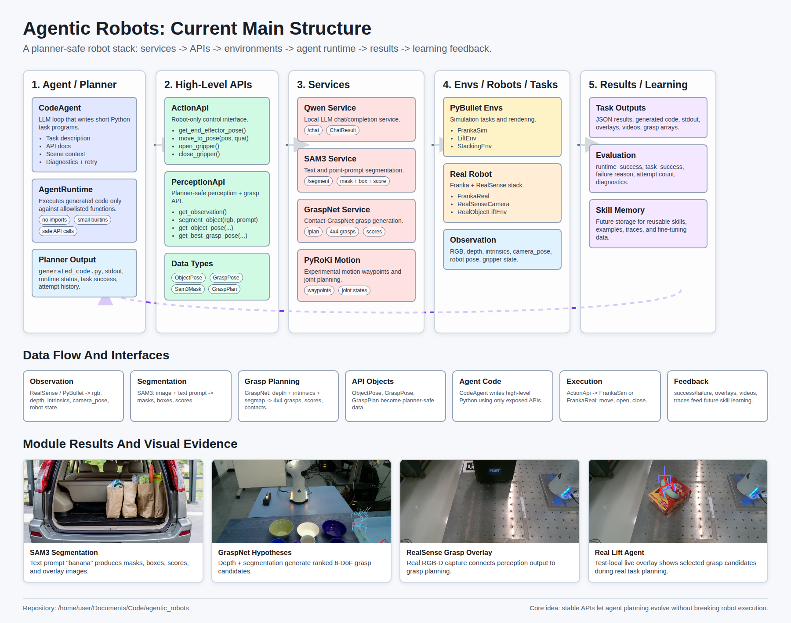

# Current Project Structure

This document describes the current `agentic_robots` repository from the bottom layers upward: services, APIs, environments, task demos, and the agent runtime.

## Visual Summary



## Layered View

```text
Local model / perception / motion services
        |
Service clients
        |
High-level APIs exposed to planner code
        |
Simulation or real robot environments
        |
CodeAgent planning + allowlisted runtime
        |
Task demos, outputs, and evaluation logs
```

## Code Structure

```text
agentic_robots/
  agent/
    code_agent.py
    runtime.py

  apis/
    base.py
    action/api.py
    perception/api.py
    perception/types.py

  services/
    base.py
    foundation_model/qwen/
      client.py
      server.py
      types.py
    sam3/
      client.py
      server.py
      types.py
    graspnet/
      client.py
      server.py
      types.py
    motion/pyroki/
      client.py
      server.py
      types.py

  envs/
    pybullet/
      franka_sim.py
      lift_env.py
      stacking_env.py
    real/
      lift_env.py
      realsense_camera.py
      franka/franka_real.py

configs/
  services.yaml
  franka_real.yaml
  lift_objects.yaml
  robot/realsense_d455_franka_calibration.yaml

tests/
  agent_test/
  api_test/
  service_tests/
  sim_test/
```

## Services

Services provide reusable HTTP boundaries around large models or specialized planners. They keep heavy dependencies out of the planner-facing APIs and make it possible to run, restart, and test each capability independently.

### Shared Service Utilities

File: `agentic_robots/services/base.py`

Core interface:

```python
ServiceConfig(url: str, timeout_s: float, retries: int, retry_delay_s: float)
post_json(config, path, payload) -> dict
encode_image(image) -> str
decode_image(image_base64) -> Image
encode_mask(mask) -> str
decode_mask(mask_base64, shape) -> np.ndarray
encode_numpy(array) -> str
decode_numpy(array_base64) -> np.ndarray
```

### Qwen Service

Files:

```text
agentic_robots/services/foundation_model/qwen/client.py
agentic_robots/services/foundation_model/qwen/server.py
agentic_robots/services/foundation_model/qwen/types.py
```

Role: local LLM completion/chat service used by the `CodeAgent`.

Client interface:

```python
QwenClient.chat(messages, model=None, temperature=0.2, max_tokens=512) -> ChatResult
QwenClient.complete(prompt, system=None, model=None, temperature=0.2, max_tokens=512) -> ChatResult
```

Current result example:

```text
tests/service_tests/outputs/qwen_chat/results.json
model: qwen3.6:latest
prompt: "Reply exactly: ok"
content: "ok"
done: true
```

### SAM3 Service

Files:

```text
agentic_robots/services/sam3/client.py
agentic_robots/services/sam3/server.py
agentic_robots/services/sam3/types.py
```

Role: text-prompt and point-prompt object segmentation.

Client interface:

```python
Sam3Client.segment(image, prompt) -> list[Sam3Mask]
Sam3Client.segment_point(image, point_xy) -> list[PointPromptResult]
```

Data types:

```python
Sam3Mask(mask, box, score, label)
PointPromptResult(mask, score)
```

Current result examples:

```text
tests/service_tests/outputs/sam3_segment/results.json
tests/service_tests/outputs/sam3_segment/overlay_00.png
tests/service_tests/outputs/sam3_live_segment/latest_overlay.png
tests/service_tests/outputs/sam3_video_tracking/sam3_tracking_demo.mp4
```

### GraspNet Service

Files:

```text
agentic_robots/services/graspnet/client.py
agentic_robots/services/graspnet/server.py
agentic_robots/services/graspnet/types.py
```

Role: Contact-GraspNet grasp candidate generation from depth, intrinsics, and segmentation.

Client interface:

```python
GraspNetClient.plan_from_depth(depth, camera_intrinsics, segmap, segmap_id=1, ...) -> GraspPlan
GraspNetClient.plan_from_point_clouds(pc_full, pc_segment, segmap_id=1, ...) -> GraspPlan
```

Data type:

```python
GraspPlan(grasps, scores, contact_points)
GraspPlan.best_grasp -> np.ndarray | None
```

Current result examples:

```text
tests/service_tests/outputs/graspnet_plan/results.json
grasp_count: 77
grasps_shape: [77, 4, 4]
best_score: 0.2847619950771332
official_grasp_render_path: tests/service_tests/outputs/graspnet_plan/official_grasps_top20.png
```

### PyRoKi Motion Service

Files:

```text
agentic_robots/services/motion/pyroki/client.py
agentic_robots/services/motion/pyroki/server.py
agentic_robots/services/motion/pyroki/types.py
```

Role: experimental motion planning service.

Current result example:

```text
tests/service_tests/outputs/pyroki_motion/results.json
waypoints_shape: [5, 8]
dt: 0.02
```

## APIs

APIs are the stable interface that the planner and generated code should call. They hide service details and robot-backend details behind readable Python functions.

### API Base

File: `agentic_robots/apis/base.py`

Interface:

```python
ApiBase.functions() -> dict[str, Callable]
ApiBase.combined_doc() -> str
```

`combined_doc()` collects function signatures and docstrings, which can be passed to an LLM planner.

### ActionApi

File: `agentic_robots/apis/action/api.py`

Role: thin robot-only action API. It wraps any robot backend that implements the required methods.

Exposed functions:

```python
get_end_effector_pose()
move_to_pose(position, quaternion_wxyz, **kwargs)
open_gripper(**kwargs)
close_gripper(**kwargs)
```

Design rule: `ActionApi` should stay robot-only. Environment-specific logic such as simulation stepping, frame recording, object state, and video capture belongs in the environment/backend.

### PerceptionApi

Files:

```text
agentic_robots/apis/perception/api.py
agentic_robots/apis/perception/types.py
```

Role: CAP-X-style perception API backed by SAM3 and GraspNet services.

Exposed functions:

```python
get_observation()
segment_object(rgb, text_prompt)
segment_point(rgb, point_xy)
get_object_pose(rgb, depth, intrinsics, object_name, camera_pose=None)
mask_to_3d_points(depth, intrinsics, mask, camera_pose=None)
get_oriented_bounding_box_from_3d_points(points)
plan_grasp(depth, intrinsics, segmentation, ...)
get_best_grasp_pose(depth, intrinsics, segmentation, camera_pose=None, ...)
```

Data types:

```python
ObjectPose(object_name, position, orientation_wxyz, mask, box, score, points, oriented_bounding_box)
OrientedBoundingBox(center, extent, rotation)
GraspPose(position, orientation_wxyz, score, transform, plan, graspnet_transform)
```

Important constraint: test-only visualization should not be added to `PerceptionApi`; visual overlays belong in tests or task wrappers.

## Environments, Robots, And Tasks

Environment classes own observations, task state, success checks, simulation stepping, rendering, and real hardware setup.

### PyBullet Robot Backend

File: `agentic_robots/envs/pybullet/franka_sim.py`

Role: simulated Franka robot backend.

Important methods:

```python
load()
reset()
get_joint_positions()
get_gripper_positions()
get_end_effector_pose()
solve_ik(position, quaternion_wxyz)
plan_to_pose(position, quaternion_wxyz, ...)
move_to_joints(joint_positions, ...)
move_to_pose(position, quaternion_wxyz, ...)
open_gripper()
close_gripper()
step()
```

### PyBullet Lift Task

File: `agentic_robots/envs/pybullet/lift_env.py`

Role: simulated object-lift task using YCB object configs.

Important methods:

```python
reset()
step_sim()
get_obs()
render_images()
start_video_recording(path)
stop_video_recording()
get_ground_truth()
get_object_pose(name)
get_object_position(name)
is_success()
draw_grasp_pose(...)
draw_grasp_candidates(...)
close()
```

Current result example:

```text
tests/agent_test/outputs/lift_agent/result.json
llm_used: true
task_success: true
attempt_count: 2
```

### PyBullet Stacking Task

File: `agentic_robots/envs/pybullet/stacking_env.py`

Role: simulated cube-stacking task with RGB-D rendering and success checks.

Important methods:

```python
reset()
step_sim()
get_obs()
render_images()
start_video_recording(path)
stop_video_recording()
get_ground_truth()
get_object_pose(name)
get_object_position(name)
is_success()
close()
```

Current result example:

```text
tests/agent_test/outputs/stacking_agent/result.json
llm_used: false
task_success: true
runtime_success: true
video_path: tests/agent_test/outputs/stacking_agent/stacking_agent.mp4
```

### Real Franka Backend

File: `agentic_robots/envs/real/franka/franka_real.py`

Role: real Franka bridge wrapper with workspace validation and gripper access.

Important methods:

```python
check_connection()
load()
get_end_effector_pose()
move_to_pose(position, quaternion_wxyz, duration_s=None)
move_to_joints(joint_positions, duration_s=None)
move_home()
open_gripper(width_m=...)
close_gripper(width_m=...)
read_gripper()
```

Important configs:

```text
configs/franka_real.yaml
configs/robot/realsense_d455_franka_calibration.yaml
```

### RealSense Camera

File: `agentic_robots/envs/real/realsense_camera.py`

Role: RealSense RGB-D capture.

Important methods:

```python
start()
capture(settle_frames=3) -> RealSenseFrame
stop()
```

### Real Object Lift Task

File: `agentic_robots/envs/real/lift_env.py`

Role: real tabletop lift environment combining Franka action backend and calibrated RealSense RGB-D.

Important methods:

```python
reset()
get_obs()
is_success()
close()
```

Observation fields:

```text
rgb
depth
intrinsics
camera_pose
images.rgb
images.depth
robot.eef_position
robot.eef_quaternion_wxyz
robot.gripper
robot.gripper_width
ground_truth.objects
```

Current result example:

```text
tests/agent_test/outputs/real_lift_agent/result.json
runtime_error: Real Franka bridge failed because the robot was in Reflex mode
tests/agent_test/outputs/real_lift_agent/live_grasp_overlay.png
```

## Agent Code

### CodeAgent

File: `agentic_robots/agent/code_agent.py`

Role: generic LLM/runtime loop for robot task code. It has no task-specific branches; callers provide the environment, task description, allowlisted APIs, success check, scene context, diagnostics, and optional fallback code.

Key configuration:

```python
CodeAgentConfig(
    task_description,
    api_functions,
    success_fn,
    system_prompt,
    api_description,
    scene_context_fn,
    diagnostics_fn,
    revision_guidance,
    fallback_code,
)
```

Run behavior:

```text
1. Build prompt from task, available APIs, and scene context.
2. Ask Qwen for short Python task code.
3. Execute the code through AgentRuntime.
4. Check runtime success and task success.
5. If needed, revise code using diagnostics and retry.
6. Return final code, runtime output, success state, and attempts.
```

### AgentRuntime

File: `agentic_robots/agent/runtime.py`

Role: executes generated Python code against an allowlisted function dictionary.

Allowed builtins are intentionally small:

```text
abs, bool, dict, float, int, len, list, max, min, print, range, str, tuple
```

This keeps generated code focused on high-level API calls instead of arbitrary imports or system access.

## Task And Test Entry Points

```text
tests/agent_test/lift_agent.py
tests/agent_test/stacking_agent.py
tests/agent_test/real_lift_agent.py
tests/agent_test/rerun_generated_code.py

tests/api_test/perception_api.py
tests/api_test/franka_real_hardware_sequence.py
tests/api_test/real_lift_env_smoke.py
tests/api_test/franka_marker_calibration_check.py

tests/service_tests/qwen_chat.py
tests/service_tests/sam3_segment.py
tests/service_tests/sam3_live_segment.py
tests/service_tests/graspnet_plan.py
tests/service_tests/pyroki_motion.py
tests/service_tests/sam3_video_tracking_demo.py
```

## Current Results And Artifacts

```text
tests/service_tests/outputs/sam3_segment/
  SAM3 segmentation masks and overlays.

tests/service_tests/outputs/graspnet_plan/
  Contact-GraspNet predictions, top grasps, scores, and render images.

tests/service_tests/outputs/realsense_grasp_hypotheses/
  RealSense RGB-D capture, mask, grasp hypotheses, and overlays.

tests/service_tests/outputs/pyroki_motion/
  Motion-planning waypoints and joint positions.

tests/agent_test/outputs/stacking_agent/
  Generated code, stdout, result JSON, and stacking video.

tests/agent_test/outputs/lift_agent/
  Generated code, stdout, result JSON, and simulated lift run.

tests/agent_test/outputs/real_lift_agent/
  Generated code, result JSON, and live grasp overlay image.
```

## Current Design Summary

- Services isolate heavy models and planners.
- APIs expose stable planner-safe functions.
- Environments own task state, observations, rendering, success checks, and backend-specific behavior.
- `CodeAgent` owns task planning and retry logic.
- `AgentRuntime` restricts generated code to allowlisted APIs.
- Test scripts are currently the main place where task-specific demos and visualization wrappers live.
